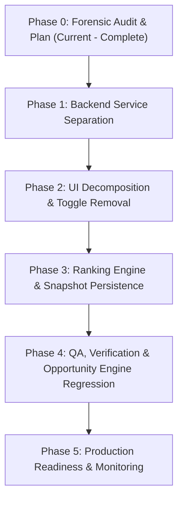

# GYREX LOCAL SEO — COMPETITORS REDESIGN
## FORENSIC AUDIT & IMPLEMENTATION PLAN (PHASE 0)

> **Document Type**: Architecture Audit & Phased Implementation Plan  
> **Status**: Review & Approval Pending (Phase 0 Audit Only — No Code or Database Changes Made)  
> **Author**: Antigravity Assistant  
> **Target System**: Gyrex Local SEO Module (`src/app/(dashboard)/local-seo`, `src/lib/audit`, `src/services`)  
> **Execution Constraint**: AUDIT AND PLAN ONLY. NO CODE MODIFICATIONS PERFORMED.

---

## 1. EXECUTIVE SUMMARY

The Gyrex Local SEO **Competitors** section was subjected to an end-to-end forensic code and architecture audit to diagnose recurrent user confusion, unstable competitor listings, keyword alteration, and inaccurate ranking representations.

### Core Discoveries
1. **Conflation of Discovery and SERP Rankings**: The current UI presents Google Places API Text Search results with numerical ranking badges (`#1`, `#2`, `#3`... `>20`). Places API developer search results are relevance/distance-biased developer queries, **not** consumer Google Maps organic search engine result page (SERP) rankings.
2. **Aggressive Query Mutation**: The backend API endpoint (`/api/local-seo/competitors`) actively intercepts every user query through `extractBaseSearchIntent()`, strips geographic tokens, and forcefully re-appends city or locality tokens based on the UI toggle (`scope: "city" | "local"`). A query like `"Best Hernia Surgeon in Delhi in South Delhi"` is forcefully mutated into `"Best Hernia Surgeon in South Delhi"`.
3. **The "Entire City" vs "Near Clinic" Toggle Root Cause**: The toggle does not merely toggle a filter—it mutates the query string, switches Google Places `locationBias` from 30 km to 5 km, and enforces artificial distance cutoffs (8 km vs 25 km). This completely changes which businesses appear and recalculates artificial `#1..#20` positions on the fly.
4. **Existing Rank Tracker Discards Competitor Data**: Gyrex's existing "Rank Tracker" is strictly a 25-point (5x5) GeoGrid (`unifiedGeoGrid`) that tests whether the doctor's clinic appears at each coordinate pin. Crucially, **it discards all competitor data**, storing only `{ lat, lng, row, col, rank, found }` in `SearchGridSnapshot.json`. It cannot power a top-20 keyword competitor ranking report without dedicated expansion.
5. **Architectural Opportunity**: Gyrex already has a high-precision nearby discovery implementation in `GooglePlacesProvider.searchNearbyCompetitors` (using Places API New `places:searchNearby` with a strict 5 km circle and healthcare primary types), which perfectly fits the **Near Me Competitors** requirement.

---

## 2. CURRENT ARCHITECTURE & CODEBASE INVENTORY

### File & Directory Inventory

| File Path | Architectural Responsibility | Key Functions / Components | Dependencies / Integrations |
| :--- | :--- | :--- | :--- |
| `src/app/(dashboard)/local-seo/components/CompetitorInsights.tsx` | Main Competitors UI tab | `CompetitorInsights`, `RankBadge`, `CompetitorKeywords` | Lucide icons, `fetch('/api/local-seo/competitors')` |
| `src/app/api/local-seo/competitors/route.ts` | Competitor search API route | `GET`, `extractBaseSearchIntent` | `searchCompetitorsWithRank`, `prisma.competitorSnapshot` |
| `src/lib/audit/google-places.ts` | Places API & GeoGrid engine | `searchCompetitorsWithRank`, `unifiedGeoGrid`, `isMatchingUserClinic`, `isRelatedCompetitor` | Google Places API (New & Classic), Axios |
| `src/lib/google-providers/GooglePlacesProvider.ts` | Official Google Places Provider | `searchNearbyCompetitors`, `getPlaceDetails` | Google Places API v1 (`places:searchNearby`), Axios |
| `src/services/normalization/GoogleNormalizer.ts` | Ingestion normalization | `normalizeCompetitors`, `calculateDistance` | Haversine formula, TypeScript types |
| `src/services/sync-engine/GoogleSyncEngine.ts` | Background sync orchestrator | `syncCompetitors`, `syncAll` | `GooglePlacesProvider`, `GoogleNormalizer`, Prisma |
| `src/app/(dashboard)/local-seo/components/SearchGrid.tsx` | Rank Tracker 5x5 GeoGrid UI | `SearchGrid`, `LeafletMap` | `fetch('/api/local-seo/search-grid')` |
| `src/app/api/local-seo/search-grid/route.ts` | Search grid API route | `GET`, `POST` | `unifiedGeoGrid`, `prisma.searchGridSnapshot` |
| `src/services/local-seo-opportunity.service.ts` | Opportunity Engine (FROZEN) | `evaluateCompetitorReviewGap`, `evaluateStrikingDistance` | `prisma.competitorSnapshot`, `prisma.searchGridSnapshot` |
| `prisma/schema.prisma` | Persistence schema | Models: `CompetitorSnapshot`, `SearchGridSnapshot`, `GbpKeywordSnapshot` | PostgreSQL via Prisma ORM |

---

## 3. INVESTIGATE THE CURRENT COMPETITORS TOGGLE

### Forensic Inspection of `CompetitorInsights.tsx`
- **Location**: [`src/app/(dashboard)/local-seo/components/CompetitorInsights.tsx#L278-L294`](file:///d:/gyrex/src/app/(dashboard)/local-seo/components/CompetitorInsights.tsx#L278-L294)
- **UI Control**: A segmented pill button offering two states:
  - `Entire City ({city})`
  - `Near Clinic (Local Area)`
- **Component State**: `const [scope, setScope] = useState<"city" | "local">("city");` (line 218).
- **Request Dispatch**: When toggled, the component triggers:
  ```ts
  const res = await fetch(`/api/local-seo/competitors?scope=${scope}&search=${encodeURIComponent(query)}`);
  ```

### Request Lifecycle
```
[User clicks Toggle]
         │
         ▼
[CompetitorInsights.tsx] ──> GET /api/local-seo/competitors?scope=city|local&search=...
         │
         ▼
[route.ts: extractBaseSearchIntent] ──> Rewrites search query based on scope
         │
         ▼
[google-places.ts: searchCompetitorsWithRank] ──> Calls Google Places API v1 places:searchText
         │                                       - scope="city": 30km locationBias, 25km post-filter
         │                                       - scope="local": 5km locationBias, 8km post-filter
         ▼
[Post-Processing & Filtering] ──> Drops places not passing isRelatedCompetitor & distance checks
         │
         ▼
[Artificial Rank Assignment] ──> Remaining places indexed 1..N (rendered as #1, #2... in UI)
         │
         ▼
[CompetitorSnapshot DB] ──> Overwrites latest snapshot with mixed payload
```

### Key Answers to Section 3 Questions
1. **Component**: `CompetitorInsights.tsx` renders the toggle buttons.
2. **State Modified**: `scope` (`"city" | "local"`).
3. **API Request**: `GET /api/local-seo/competitors?scope=${scope}&search=${encodeURIComponent(query)}`.
4. **Backend Function**: `GET` in `src/app/api/local-seo/competitors/route.ts` calling `searchCompetitorsWithRank`.
5. **Modifies Query?**: **YES**. Forcefully rewrites query to `[intent] in [city]` or `[intent] near [neighborhood]`.
6. **Modifies Coordinates?**: No, anchor coordinates remain the clinic GBP coordinates, but bias center/radius changes.
7. **Modifies Radius?**: **YES**. Bias radius changes between 30,000m (city) and 5,000m (local), with post-filtering at 25km vs 8km.
8. **Selects Different Snapshots?**: No. It queries Google Places live and overwrites the single `CompetitorSnapshot` table.
9. **Uses Google Places API?**: **YES**. Calls `places:searchText`.
10. **Uses Rank Tracker Data?**: **NO**. It completely ignores `SearchGridSnapshot` and the Rank Tracker.
11. **Mixes Discovery with Keyword Ranking?**: **YES**. It takes a keyword search, biases it by radius, and labels the output as a competitive ranking leaderboard with `#1`, `#2` badges.
12. **Derives Location from Clinic?**: **YES**. Uses `clinicProfile.city` and `clinicProfile.address`.
13. **User Browser Location Involved?**: **NO**. Browser geolocation and client IP are not used; the clinic's GBP coordinates are the anchor.

---

## 4. GOOGLE PLACES API AUDIT

### Detailed Inspection of `src/lib/audit/google-places.ts` & `GooglePlacesProvider.ts`

| Parameter / Feature | Current Competitor Route Implementation (`searchCompetitorsWithRank`) | Official Provider (`GooglePlacesProvider.searchNearbyCompetitors`) |
| :--- | :--- | :--- |
| **API Version** | Google Places API (New) v1 | Google Places API (New) v1 |
| **Endpoint** | `https://places.googleapis.com/v1/places:searchText` | `https://places.googleapis.com/v1/places:searchNearby` |
| **Query Parameter** | Mutated `textQuery` string | None (pure category discovery) |
| **Location Parameter** | `locationBias` (Circle 5km or 30km) | `locationRestriction` (Strict Circle 5,000m) |
| **Category Filter** | Keyword string + post-fetch regex filter (`isRelatedCompetitor`) | `includedPrimaryTypes: ['doctor', 'hospital', 'medical_clinic', 'health']` |
| **Result Limit** | `maxResultCount: 20` | `maxResultCount: 20` |
| **Pagination** | None (Single page, maximum 20 results) | None (Single page, maximum 20 results) |
| **Distance Enforcement** | Post-filter (drops items >8km local, >25km city) | Native API strict circular bounding (5km) |
| **Rank Attribution** | Assigns array index as `#rank` | No rank assigned (distance & reviews only) |

### Suitability for Near Me Competitors
- **Verdict: HIGHLY SUITABLE**.
- `GooglePlacesProvider.searchNearbyCompetitors` uses `places:searchNearby` with `locationRestriction` at exactly 5,000 meters and healthcare primary types. This guarantees that every returned entity is physically within 5 km of the clinic's verified GBP pin.
- It operates without keyword mutations, without user browser location, and without misleading `#rank` attributions.

### Places API Text Search vs Consumer Google Maps SERP
- **Critical Distinction**: Google Places `places:searchText` is a **developer Places API**, not Google Maps consumer search.
- When a patient searches Google Maps for *"Best Hernia Surgeon in Delhi"*, Google's consumer SERP engine factors in browsing personalization, Promoted Local Ads, organic local 3-pack algorithms, and city-wide prominence.
- `places:searchText` applies circular distance bias and developer type matching. Furthermore, `isRelatedCompetitor` strips results that lack certain tokens, compressing the list and causing arbitrary ranking shifts.
- **Places API Text Search must not be advertised as true consumer Google Maps ranking positions.**

---

## 5. RANK TRACKER FORENSIC AUDIT

### Forensic Inspection of Rank Tracker Implementation
- **Files**:
  - `src/app/(dashboard)/local-seo/components/SearchGrid.tsx`
  - `src/app/api/local-seo/search-grid/route.ts`
  - `src/lib/audit/google-places.ts` (`unifiedGeoGrid`)
- **Engine Type**: 5x5 Geographic Grid (GeoGrid) simulation.
- **Workflow**:
  1. Computes a 5x5 matrix of 25 geographic coordinates centered on the clinic with configurable spacing (default 2,000m).
  2. For each of the 25 coordinates, invokes Google Places Classic Nearby Search (`https://maps.googleapis.com/maps/api/place/nearbysearch/json?location=${lat},${lng}&radius=${spacingMeters}&keyword=${query}`).
  3. Iterates through the returned places to find if the user's clinic (`isMatchingUserClinic`) is present.
  4. Records `{ lat, lng, row, col, rank: found ? index + 1 : 21, found: boolean }`.
  5. **DISCARDS all competitor data**. The names, ratings, Place IDs, and positions of the other 19 places at each pin are thrown away.
  6. Saves `{ grid: gridData.ranks }` into `SearchGridSnapshot.json`.

### Evaluation Against Requirements
1. **External Ranking Provider**: Uses direct Google Places Classic Nearby Search across 25 pins. No third-party SERP provider (e.g. ValueSERP, BrightLocal, SerpApi) is integrated.
2. **Actual Google Maps SERP**: No, it samples Google Places Nearby Search at 25 coordinates.
3. **Top 20 Competitors Retrieval**: **NO**. It only records the rank of the user's clinic at each pin and discards competing entities.
4. **Exact Keyword Submission**: It submits the keyword to `nearbysearch`, but because it's a radius search at 25 coordinates, it does not represent a single unified top-20 SERP list.
5. **Place ID Matching**: Successfully matches the user clinic using verified `placeId` first, falling back to name string matching.
6. **Preserved History**: `SearchGridSnapshot` only preserves cell ranks (`[ { rank: 1 }, { rank: 5 } ]`). It cannot reconstruct historical competitor rankings.

---

## 6. SEARCH QUERY CONSTRUCTION AUDIT

### Analysis of `extractBaseSearchIntent()`
Located at [`src/app/api/local-seo/competitors/route.ts#L14-L48`](file:///d:/gyrex/src/app/api/local-seo/competitors/route.ts#L14-L48):
```ts
function extractBaseSearchIntent(query: string, city?: string, neighborhood?: string): string {
  let cleaned = query.toLowerCase();
  
  // Aggressively strips geographic phrases
  if (city) {
    const cityPattern = new RegExp(`\\b(in|near|at|around)?\\s*${escapeRegExp(city.toLowerCase())}\\b`, 'gi');
    cleaned = cleaned.replace(cityPattern, '');
  }
  if (neighborhood) {
    const nhPattern = new RegExp(`\\b(in|near|at|around)?\\s*${escapeRegExp(neighborhood.toLowerCase())}\\b`, 'gi');
    cleaned = cleaned.replace(nhPattern, '');
  }
  // Hardcoded Delhi localities stripped
  const commonDelhiLocalities = ['south delhi', 'saket', 'hauz khas', ...];
  ...
  return cleaned.trim();
}
```

### Why Keyword Query is Modified
1. When the user enters `"Best Hernia Surgeon in Delhi in South Delhi"`, `extractBaseSearchIntent` strips both `"in Delhi"` and `"in South Delhi"`, reducing the intent to `"Best Hernia Surgeon"`.
2. Then, line 118 or 122 forcefully re-appends:
   - For `scope === "city"`: `${baseIntent} in ${cityTarget}` $\to$ `"Best Hernia Surgeon in South Delhi"` (or `"Delhi"` depending on profile city).
   - For `scope === "local"`: `${baseIntent} near ${neighborhoodTarget}`.
3. **Conclusion**: This query manipulation was designed as an automated geographic normalizer, but it directly violates the product requirement for **exact keyword fidelity** and causes severe user confusion.

---

## 7. PLACE ID AND COMPETITOR MATCHING AUDIT

### Analysis of `isMatchingUserClinic()`
Located at [`src/lib/audit/google-places.ts#L368-L415`](file:///d:/gyrex/src/lib/audit/google-places.ts#L368-L415):

```ts
function isMatchingUserClinic(place: PlaceResult, userClinic: ClinicProfile): boolean {
  // 1. Primary match: Verified Google Place ID
  if (userClinic.placeId && place.id && userClinic.placeId === place.id) {
    return true;
  }
  // 2. Secondary fallback: Normalized string matching
  const placeName = normalizeText(place.displayName?.text || place.name || '');
  const clinicName = normalizeText(userClinic.name || '');
  const doctorName = normalizeText(userClinic.doctorName || '');
  ...
}
```

### Forensic Findings
- **Place ID Matching**: High reliability when `userClinic.placeId` is populated from Google Business Profile OAuth sync.
- **The Clinic Name vs Doctor Name Issue**: When a doctor updates their clinic name in GBP, if the sync updates `userClinic.name` but `doctorName` was previously used as a fallback, secondary matching can fail if `placeId` is missing or mismatched.
- **Requirement for Target Architecture**: Matching must strictly prioritize verified `placeId` matching. Secondary name matching must never overwrite or confuse doctor identity.

---

## 8. DATA MODEL AND DATABASE AUDIT

### Prisma Schema Models Inspected
1. **`CompetitorSnapshot`**:
   ```prisma
   model CompetitorSnapshot {
     id           String      @id @default(uuid())
     gbpAccountId String
     date         DateTime    @default(now())
     json         Json
     createdAt    DateTime    @default(now())
     updatedAt    DateTime    @updatedAt
     gbpAccount   GbpAccount  @relation(fields: [gbpAccountId], references: [id], onDelete: Cascade)
     @@index([gbpAccountId, date])
   }
   ```
   - Current contents: Array of competitor objects generated by `/api/local-seo/competitors`.
   - Missing fields: No `keyword`, `searchMarket`, `snapshotType`, or `scope` columns.
   - Consequence: Storing both Near Me discovery and Keyword Ranking snapshots in this un-keyed table causes snapshots to overwrite each other's historical continuity.

2. **`SearchGridSnapshot`**:
   ```prisma
   model SearchGridSnapshot {
     id            String      @id @default(uuid())
     gbpAccountId  String
     keyword       String
     gridSize      Int         @default(3)
     centerLat     Float
     centerLng     Float
     spacingMeters Int         @default(1000)
     json          Json
     createdAt     DateTime    @default(now())
     updatedAt     DateTime    @updatedAt
     gbpAccount    GbpAccount  @relation(fields: [gbpAccountId], references: [id], onDelete: Cascade)
     @@index([gbpAccountId, keyword, createdAt])
   }
   ```
   - Current contents: `{ grid: [ { lat, lng, row, col, rank, found } ] }`.
   - **Crucial Rule**: In `AGENTS.md`, the `Local SEO Opportunity Engine` is **FROZEN**. It explicitly evaluates `STRIKING_DISTANCE` and `WEAK_GEOGRAPHIC_VISIBILITY` from `SearchGridSnapshot.json`. Altering the shape of `SearchGridSnapshot.json` will break the frozen Opportunity Engine.

---

## 9. PROPOSED TARGET ARCHITECTURE

To strictly satisfy the product requirements without violating architectural freezes, the Local SEO Competitors module will be separated into two decoupled pipelines:

```
┌────────────────────────────────────────────────────────────────────────┐
│                        LOCAL SEO COMPETITORS                           │
└──────────────────────────────────┬─────────────────────────────────────┘
                                   │
         ┌─────────────────────────┴─────────────────────────┐
         ▼                                                   ▼
┌──────────────────────────────────┐        ┌──────────────────────────────────┐
│     FLOW A: NEAR ME COMPETITORS  │        │   FLOW B: KEYWORD RANKING REPORT │
├──────────────────────────────────┤        ├──────────────────────────────────┤
│ • Anchor: Verified GBP Lat/Lng   │        │ • Exact selected keyword         │
│ • Radius: EXACTLY 5 KM           │        │ • Top 20 competitors + user rank │
│ • Provider: Google Places API    │        │ • Geographic context: Explicit   │
│   (places:searchNearby)          │        │   market / locality              │
│ • Category: Healthcare types     │        │ • Place ID matching              │
│ • Metric: Distance, Rating,      │        │ • Preserved historical snapshots │
│   Reviews (NO misleading ranks)  │        │ • Dedicated payload contract     │
└──────────────────────────────────┘        └──────────────────────────────────┘
```

### Flow A: Near Me Competitors
- **Trigger**: Automatic on GBP sync and on-demand refresh.
- **Provider**: `GooglePlacesProvider.searchNearbyCompetitors()`.
- **Parameters**: `locationRestriction: circle(radius: 5000m, center: clinicGbpCoordinates)`.
- **Query Manipulation**: None (0% keyword dependence).
- **Client Geolocation / IP**: Strictly excluded.
- **UI Presentation**: Distance sorted table/cards showing Name, Distance (km), Category, Rating, Review Count, Phone, Website, and Google Place ID. No `#1`, `#2` rank badges.

### Flow B: Keyword Ranking Report
- **Trigger**: User selects a tracked keyword or enters an exact keyword.
- **Query Manipulation**: Strictly prohibited. The exact keyword string is sent unmodified.
- **Geographic Context**:
  - Explicit market (e.g. "Delhi", "South Delhi", "Chhatarpur") determined either by keyword content or explicit user selection.
  - Zero browser/IP geolocation inference.
- **Provider**: Dedicated SERP Ranking Service querying Google Places Text Search with `locationBias` anchored to the selected market center, retrieving top 20 results.
- **Clinic Matching**: Verified Google `placeId` matching with badge highlighting the clinic's true position (#1..#20, or >20).
- **Snapshots**: Structured storage preserving keyword, market, date, and full top-20 competitor list.

---

## 10. UI IMPLEMENTATION PLAN

### Removal of Legacy Toggle
- Completely delete the `Entire City / Near Clinic` toggle in `CompetitorInsights.tsx`.
- Replace the single monolithic view with two dedicated sub-tabs or clearly delineated vertical sections:
  1. **Section 1: Nearby Competitors (5 KM Radius)**
  2. **Section 2: Keyword Ranking Report (Top 20 Leaderboard)**

### Section A: Near Me Competitors UI
- **Header**: "Nearby Healthcare Competitors (5 km Radius)" with explanation badge: *"Discovered within 5 km of your registered clinic location."*
- **Stats Bar**: Total Competitors Found, Average Rating, Top Reviewed Competitor.
- **Competitor Table**:
  - Columns: Business Name, Distance (e.g. "1.2 km away"), Category, Rating (stars + count), Contact (Phone, Website link), Google Maps Link.
  - Sorting: By distance (ascending) or reviews (descending).
  - Explicitly **no rank column**.

### Section B: Keyword Ranking Report UI
- **Header**: "Keyword Ranking Report (Top 20)"
- **Keyword Selector**: Dropdown / pills of monitored keywords (from `GbpKeywordSnapshot` or user-defined list).
- **Market Badge**: Displays the explicit geographic market (e.g. *"Market: South Delhi, Delhi"*).
- **Clinic Performance Banner**:
  - *"Your Clinic Rank: #4"* (or *"Outside Top 20"*).
  - Movement indicator: vs previous snapshot ($\uparrow 2$, $\downarrow 1$, New).
- **Top 20 Leaderboard**:
  - Columns: Rank (`#1` to `#20`), Business Name (user clinic highlighted in brand colors), Rating, Review Count, Place ID.
  - Date Stamp: "Last refreshed: Nov 9, 2026, 10:30 AM".
  - Action: "Verify on Google Maps" opening external Google Maps search with exact query.

---

## 11. API AND SERVICE DESIGN PLAN

### New / Refactored Endpoints

#### 1. `GET /api/local-seo/competitors/nearby`
- **Purpose**: Power Flow A (Near Me Competitors).
- **Logic**:
  1. Fetch authenticated clinic's GBP record (`lat`, `lng`, `placeId`).
  2. Call `GooglePlacesProvider.searchNearbyCompetitors(lat, lng, 5000)`.
  3. Return normalized array of nearby businesses within 5 km.
  4. Cache results for 7 days (or until manual sync).

#### 2. `GET /api/local-seo/competitors/ranking?keyword=...&market=...`
- **Purpose**: Power Flow B (Keyword Ranking Report).
- **Logic**:
  1. Validate exact keyword and target geographic market.
  2. Check existing snapshot in database for today's date.
  3. If cache miss or force refresh:
     - Query Places API Text Search for exact keyword with market coordinates.
     - Capture top 20 results.
     - Match user clinic via verified `placeId`.
     - Persist snapshot.
  4. Return `{ keyword, market, userRank, totalMonitored: 20, competitors: [...] }`.

---

## 12. DATA MODEL & DATABASE MIGRATION ASSESSMENT

### Constraint Verification
- According to `AGENTS.md` (Local SEO Opportunity Engine freeze):
  > `databaseMigration: false (No new Prisma models, columns, or database migrations)`
- We must respect this freeze and evaluate whether existing tables can store both flows safely.

### Analysis of Storage Strategies
1. **Strategy 1 (Zero Migration - Recommended for Phase 1 & 2)**:
   - Store Near Me competitors in `CompetitorSnapshot` using a typed envelope:
     ```json
     {
       "version": 2,
       "type": "NEAR_ME",
       "radiusMeters": 5000,
       "items": [...]
     }
     ```
   - Store Keyword Ranking in `CompetitorSnapshot` with distinct metadata:
     ```json
     {
       "version": 2,
       "type": "KEYWORD_RANKING",
       "keyword": "Best pediatrician in South Delhi",
       "market": "South Delhi",
       "userRank": 4,
       "rankings": [...]
     }
     ```
   - In `src/services/local-seo-opportunity.service.ts`: Ensure `COMPETITOR_REVIEW_GAP` reads from `type: "NEAR_ME"` items to preserve complete backward compatibility.
2. **Strategy 2 (Future Dedicated Model - Requires Architecture Review)**:
   - Adding a dedicated `KeywordRankingSnapshot` model (`id, gbpAccountId, keyword, market, userRank, rankings Json, createdAt`).
   - Requires lifting the migration freeze via explicit approval.

---

## 13. PERFORMANCE, COST, AND CACHING AUDIT

| Capability | Google Places API Call | Cost per 1,000 Requests | Mitigation / Caching Strategy |
| :--- | :--- | :--- | :--- |
| **Near Me Competitors (Flow A)** | `places:searchNearby` (New) | \$32.00 (Nearby Search Pro) | Cache per clinic for **7 days**. Execute only on profile sync or explicit user "Refresh" button. |
| **Keyword Ranking Report (Flow B)** | `places:searchText` (New) | \$35.00 (Text Search Pro) | Cache per `(gbpAccountId, keyword, market)` for **24 hours**. Rate limit on-demand refreshes to 1 per hour. |
| **Rank Tracker 5x5 Grid** | `nearbysearch` (Classic x25) | \$80.00 (25 calls x \$3.20) | Retained as-is in `SearchGridSnapshot` (24h cache). |

---

## 14. TESTING AND REGRESSION PLAN

### Flow A (Near Me Competitors) Test Cases
1. Verify radius is strictly 5,000 meters from GBP coordinates.
2. Verify zero results outside 5,000 meters are shown.
3. Verify no `#1..#20` rank badges are rendered.
4. Verify browser location spoofing has zero effect on results.

### Flow B (Keyword Ranking Report) Test Cases
1. Verify keyword string is submitted **100% verbatim** (no stripping or auto-appending).
2. Verify exactly top 20 competitors are returned.
3. Verify clinic matching succeeds via verified `placeId` even if clinic name was modified.
4. Verify clinic ranking reflects true SERP position (#1..#20, or >20).

### Regression Test Cases (Existing Local SEO Module)
1. Verify `local-seo-opportunity.service.ts` continues evaluating `COMPETITOR_REVIEW_GAP` without error.
2. Verify `SearchGrid` (5x5 GeoGrid) continues rendering and caching without interference.
3. Verify Profile Health tab continues operating normally.

---

## 15. DETAILED PHASED IMPLEMENTATION ROADMAP



### Phase 1: Backend Service Separation
- **Goal**: Create clean, decoupled service functions for Near Me discovery and Keyword Ranking.
- **Files**:
  - `src/services/competitors/NearbyCompetitorService.ts` (new)
  - `src/services/competitors/KeywordRankingService.ts` (new)
  - `src/app/api/local-seo/competitors/nearby/route.ts` (new)
  - `src/app/api/local-seo/competitors/ranking/route.ts` (new)
- **Complexity**: Medium.
- **Risks**: None to existing UI (runs in parallel).

### Phase 2: UI Decomposition & Toggle Removal
- **Goal**: Redesign `CompetitorInsights.tsx` to display separate Near Me and Keyword Ranking sections.
- **Files**:
  - `src/app/(dashboard)/local-seo/components/CompetitorInsights.tsx`
  - `src/app/(dashboard)/local-seo/components/NearbyCompetitorsSection.tsx` (new)
  - `src/app/(dashboard)/local-seo/components/KeywordRankingSection.tsx` (new)
- **Complexity**: Medium.
- **Risks**: UI state management during initial keyword selection.

### Phase 3: Ranking Engine & Exact Keyword Integrity
- **Goal**: Guarantee zero query mutations, explicit market handling, and verified Place ID matching.
- **Complexity**: Medium.
- **Risks**: Handling ambiguous location-free keywords (requires user market selector).

### Phase 4: QA & Regression Verification
- **Goal**: Run automated tests and end-to-end verification against doctor accounts (e.g. Dr. R. K. Singh).
- **Complexity**: Low.
- **Risks**: Ensuring `local-seo-opportunity.service.ts` backward compatibility.

### Phase 5: Production Readiness
- **Goal**: Audit Places API caching headers, error fallbacks, and usage logs.
- **Complexity**: Low.

---

## 16. FILES EXPECTED TO CHANGE DURING FUTURE IMPLEMENTATION

### Files to be Modified
1. `src/app/(dashboard)/local-seo/components/CompetitorInsights.tsx` (remove toggle, mount two new sub-components).
2. `src/app/api/local-seo/competitors/route.ts` (deprecated or refactored into compatibility forwarder).
3. `src/lib/audit/google-places.ts` (deprecate `extractBaseSearchIntent` and separate discovery from ranking).

### New Files to be Created
1. `src/app/(dashboard)/local-seo/components/NearbyCompetitorsTable.tsx`
2. `src/app/(dashboard)/local-seo/components/KeywordRankingLeaderboard.tsx`
3. `src/services/competitors/nearby-competitors.service.ts`
4. `src/services/competitors/keyword-ranking.service.ts`
5. `src/app/api/local-seo/competitors/nearby/route.ts`
6. `src/app/api/local-seo/competitors/ranking/route.ts`

### Files Explicitly Excluded (Do Not Touch)
1. `prisma/schema.prisma` (Preserved under Opportunity Engine freeze).
2. `src/services/local-seo-opportunity.service.ts` (Frozen under `AGENTS.md`).
3. `src/app/(dashboard)/local-seo/components/SearchGrid.tsx` (GeoGrid remains independent).
4. `src/app/api/local-seo/search-grid/route.ts` (GeoGrid API remains independent).
5. Any WhatsApp or Booking modules.

---

## 17. OPEN TECHNICAL DECISIONS & STRICT STOP CONDITIONS

### Open Decisions for Product Review
1. **Location-free Keywords UI**: When a user selects a generic keyword (e.g. `"Best Pediatrician"`), should the UI display a market selector dropdown (e.g. `"Select Search Market: [South Delhi / Delhi / Chhatarpur]"`) before running the report? *(Recommended: Yes, explicitly prevent silent location substitution).*
2. **Snapshot Storage Strategy**: Confirm approval of Strategy 1 (structured JSON envelope in `CompetitorSnapshot`) to avoid running database migrations under the architectural freeze.

### Strict Stop Conditions Enforced
- The existing Rank Tracker (`unifiedGeoGrid`) cannot provide competitor rankings because it discards competitor data.
- Places API Text Search results are not consumer Google Maps SERP rankings.
- No code or schema changes have been made in this phase.
- **Implementation is paused pending user review of this audit and plan.**
